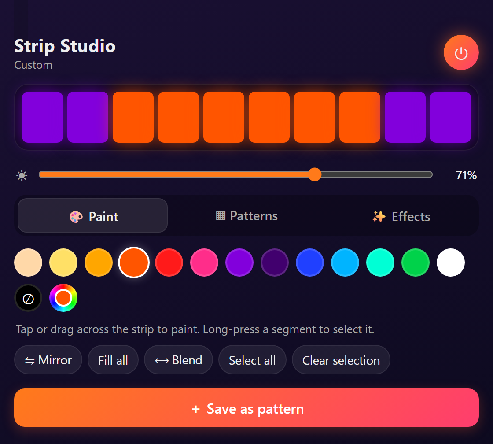
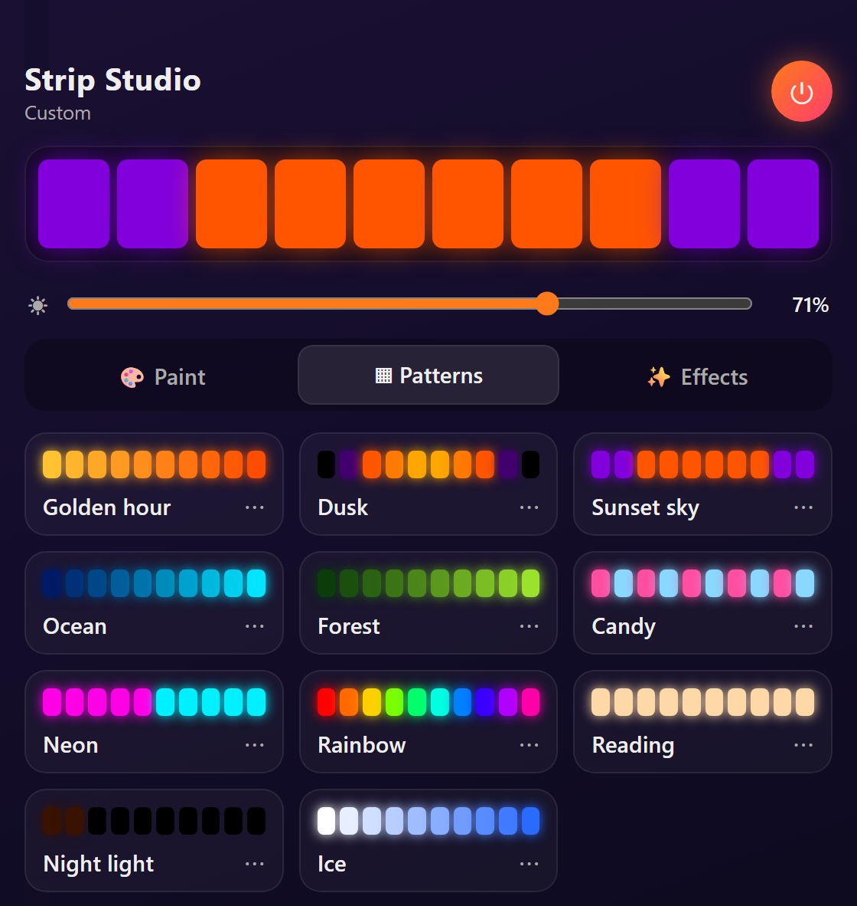
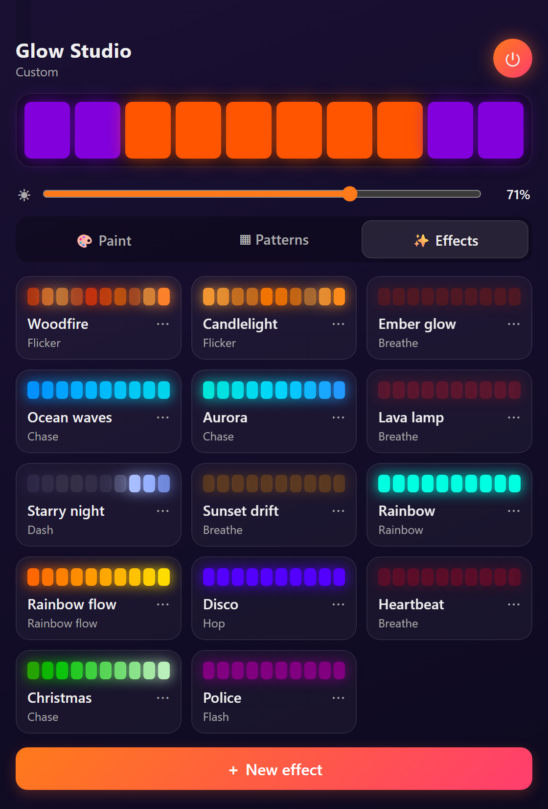
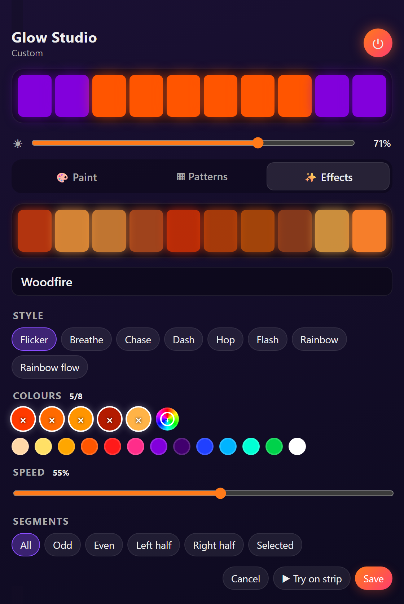
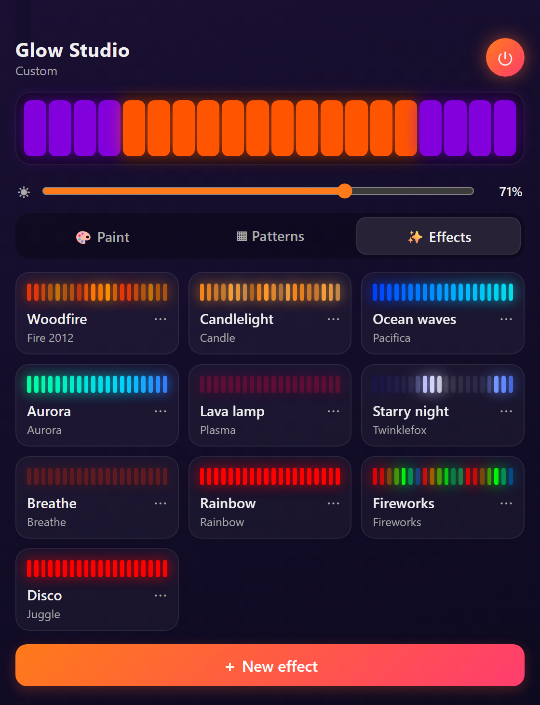

# Glow Studio

[](https://hacs.xyz/docs/faq/custom_repositories)
[](https://github.com/danish-din/glow-studio-card/actions/workflows/validate.yml)

A Home Assistant dashboard card for **addressable LED strips**: paint every segment its own colour, save your designs,
and run the strip's own animated effects (woodfire, candlelight, aurora…) with your own colours.
Like the Yeelight / Aqara / Govee apps, but inside Home Assistant and shared by everyone in the house.

<p align="center">
  
  
  
</p>

## Supported strips

| Strip | Paint | Effects | Status |
| --- | --- | --- | --- |
| **Aqara LED Strip T1** (Zigbee2MQTT) | every 20 cm segment | 8 hardware styles with your own colours, speed and segments | ✅ tested on real hardware |
| **Aqara Ceiling Light T1M / T1** ring (Zigbee2MQTT) | 26 / 20 segments | 6 hardware styles with your own colours and speed | 🧪 beta |
| **Philips Hue gradient** strips (Zigbee2MQTT) | up to 9 colour points, blended | Hue's 12 effects (candle, fireplace, sunrise, cosmos…) | 🧪 beta |
| **WLED** | any number of cells across all LEDs | every WLED effect, with 3 colours and speed | 🧪 beta |
| **Anything that exposes each segment as its own light** (govee2mqtt, WLED segments, Tuya…) | one cell per light | the main light's effect list | 🧪 beta |

The strip type is detected automatically; you can also pick it in the card editor. **Beta** drivers are built against
each device's published API and covered by tests, but not yet confirmed on real hardware. Please
[open an issue](https://github.com/danish-din/glow-studio-card/issues) with how it went on yours.

## Features

- **🎨 Paint**: tap or drag across a live preview of the strip. Long-press to select segments, **Mirror** for symmetric designs, **Blend** for smooth gradients, quick swatches plus a full colour picker.
- **▦ Patterns**: save designs with a name; apply, rename, update or delete them. 11 starters included (Golden hour, Dusk, Ocean, Forest, Neon, Rainbow…), resized to your strip.
- **✨ Effects**: ready-made effects for your strip type (Woodfire, Candlelight, Ocean waves, Aurora, Starry night…). Make your own: pick a style, colours, speed and (on the T1) which segments it runs on. **▶ Try it** before saving.
- **Runs on the strip.** Effects use the device's own effect engine, so they're smooth and don't flood your network.
- **Shared library.** Patterns and effects live in a retained MQTT topic, mirrored into an MQTT sensor, so every device sees the same library. No extra integration needed.
- Brightness and power controls built in, visual card editor, follows reduced-motion settings.

<p align="center">
  
  
</p>

## Requirements

- The **MQTT** integration in Home Assistant (used to store the shared library, and to talk to Zigbee2MQTT / WLED).
- **Aqara / Hue gradient:** paired with [Zigbee2MQTT](https://www.zigbee2mqtt.io/) 2.x (ZHA isn't supported).
- **WLED:** the [WLED integration](https://www.home-assistant.io/integrations/wled/) for effects, plus **MQTT enabled in WLED** (Config → Sync Interfaces) for painting and effect colours.

## Installation

### HACS (recommended)

1. HACS → ⋮ → **Custom repositories** → add `https://github.com/danish-din/glow-studio-card`, type **Dashboard**.
2. Search for **Glow Studio**, install, and reload your browser.

### Manual

1. Download `glow-studio-card.js` from the [latest release](https://github.com/danish-din/glow-studio-card/releases).
2. Copy it to `config/www/`.
3. Settings → Dashboards → ⋮ → **Resources** → add `/local/glow-studio-card.js` as a **JavaScript module**.

## Usage

Add the card from the dashboard editor (search "Glow Studio") and pick your strip. The first time, the card shows
**✨ Set up Glow Studio**; tap it to create the shared library with starter patterns and effects.

```yaml
# Aqara T1 / T1M / Hue gradient: usually just this
type: custom:glow-studio-card
entity: light.bedroom_strip
```

```yaml
# WLED
type: custom:glow-studio-card
entity: light.desk_wled
wled_topic: wled/desk      # WLED → Config → Sync Interfaces → MQTT "Device Topic"
segments: 30               # paint cells spread across all LEDs (default 20)
```

```yaml
# Any integration that gives each segment its own light
type: custom:glow-studio-card
entity: light.tv_backlight          # main light: power, brightness, effects
segment_entities:
  - light.tv_backlight_segment_1
  - light.tv_backlight_segment_2
  - light.tv_backlight_segment_3
```

| Option | Default | Description |
| --- | --- | --- |
| `entity` | **required** | The strip's (main) light entity. |
| `driver` | auto | `aqara_t1`, `aqara_t1m`, `hue_gradient`, `wled` or `segment_lights`. |
| `title` | `Glow Studio` | Card title. |
| `segments` | auto | Paint cells. T1: strip length × 5. T1M: 26/20. Hue: 5 (max 9). WLED: 20 (max = LED count). |
| `z2m_topic` | auto | Zigbee2MQTT set topic, e.g. `zigbee2mqtt/Bedroom Strip/set`. Auto-detected from the device name. |
| `z2m_base` | `zigbee2mqtt` | Zigbee2MQTT base topic, if you changed it. |
| `wled_topic` | — | WLED's MQTT device topic. Needed to paint. |
| `leds` | auto | WLED total LED count (read from the WLED "LED count" sensor if available). |
| `segment_entities` | — | Segment lights in order along the strip (segment-lights driver). |
| `library_topic` | `glow_studio/<light>/library` | Retained MQTT topic that stores the library. |
| `library_entity` | `sensor.glow_studio_<light>` | MQTT sensor that mirrors the library. |

### Tip: open Glow Studio instead of the normal light dialog

With [browser_mod](https://github.com/thomasloven/hass-browser_mod), tapping the light can open Glow Studio:

```yaml
type: custom:popup-card
target:
  entity_id: light.bedroom_strip
popup_card_all_views: true
title: Bedroom strip
card:
  type: custom:glow-studio-card
  entity: light.bedroom_strip
```

## How it works

Each strip family has a small **driver** (`src/drivers/`) that knows how to paint, run effects and count segments:

- **Aqara T1 / T1M**: Zigbee2MQTT `segment_colors`; effects via `effect_colors`, `effect_segments`, `effect_speed`, `effect`.
- **Hue gradient**: Zigbee2MQTT `gradient` (list of hex colours) and `effect` + `effect_speed`.
- **WLED**: WLED's MQTT JSON API (`<topic>/api`) with per-LED `i` ranges; effects via Home Assistant's WLED light, colours and speed via `col` / `sx`.
- **Segment lights**: `light.turn_on` / `turn_off` per segment entity.

The library is one JSON document on a retained MQTT topic, exposed through an MQTT-discovery sensor's attributes,
so any change from any device updates everyone. Adding a strip type means adding one driver file; PRs welcome.

## Development

```bash
npm install
npm test        # unit, driver and DOM tests (node:test + happy-dom) with coverage
npm run build   # bundles src/ into dist/glow-studio-card.js
```

Serve the repo root and open `dev/index.html` for a mock Home Assistant (`?driver=wled`, `?driver=hue`, `?tab=effects`).

## Licence

MIT
